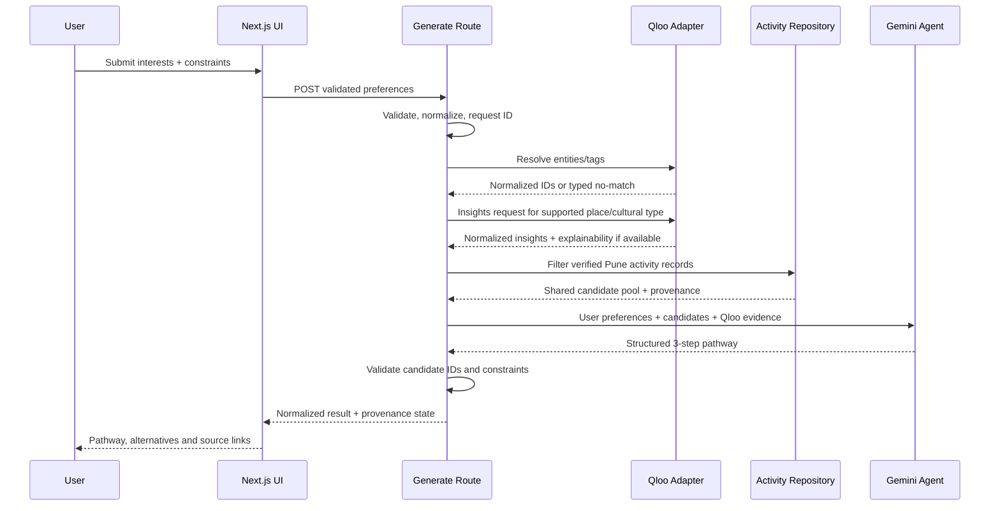

# Architecture and Agent Workflow

## 1. Design principles

- Server owns secrets and provider requests.
- Qloo signals should change candidate ranking; don't use Qloo as decoration.
- Verified activity facts remain separate from model-written explanations.
- Hard constraints are deterministic; LLM provides sequencing and user-facing rationale.
- Candidate pools are shared for fair comparison.
- The agent is bounded, typed and observable—not a free-roaming browser agent.

## 2. Layered components

### UI layer
- Guided onboarding state.
- Pathway result/card rendering.
- Separate comparison presentation.
- Google sign-in and saved-history presentation.
- Clear loading, empty, partial and provider failure states.

### Application/service layer
- Preference normalizer.
- Pathway generation use case.
- Benchmark comparison use case.
- Candidate filter and ranking policy.
- History model mapper.

### Provider adapters
- Qloo Search/Tags/Insights adapter.
- Gemini model/function-calling adapter.
- Firebase Auth/Firestore client adapter.
- Activity repository adapter (curated file first, optional verified live source later).

### Data and provenance
- Curated activities with source evidence.
- Qloo response normalization kept server-side.
- Saved pathway summary and activity snapshots for the signed-in owner.

## 3. Pathway generation sequence

## 4. Comparison sequence

1. Validate one canonical user profile.
2. Fetch and filter the verified activity candidate pool once.
3. Execute baseline ranking with that pool and user profile, with Qloo fields removed.
4. Execute Qloo arm using the same pool, profile, hard constraints and comparable Gemini settings, adding normalized actual Qloo outputs.
5. Validate both outputs against the same schema.
6. Calculate only defined, deterministic metrics and return both methods' status.
7. Show the results side by side/clearly separated per the reference visual language, without fabricated scores.

Use separate run IDs and timestamps. For a deterministic demo comparison, allow the same recorded input/profile and record the model/version/config used. Do not compare one arm using stale candidates to another using a different live pool.

## 5. Activity source adapter

The MVP repository may load a vetted static JSON/TypeScript dataset. The adapter should expose:

- `listVerifiedActivities(criteria)`
- `getActivityById(id)`
- `getDatasetCoverage()`

An optional live source adapter may be added only when the source has a documented/API-allowed way to retrieve data and the team can verify location, schedule and registration facts. Keep provider-specific fields separate, stamp retrieval/verification time and merge records into the same canonical data schema before ranking. Do not scrape pages contrary to source rules or fabricate a live endpoint.

## 6. Failure isolation

- Qloo failure does not permit false Qloo claims. It may produce a baseline-only pathway only when the user is told that Qloo is unavailable and the result is clearly labeled.
- Gemini failure must not return invalid JSON as a successful pathway. One schema repair attempt is allowed, then typed failure.
- Activity source failure may use only already vetted local records, labelled with their true verification date. Don't present old records as live availability.
- Firebase/Auth failure must not break guest generation.
- A history read/write failure must not discard the current unsaved pathway; show a retryable error.
