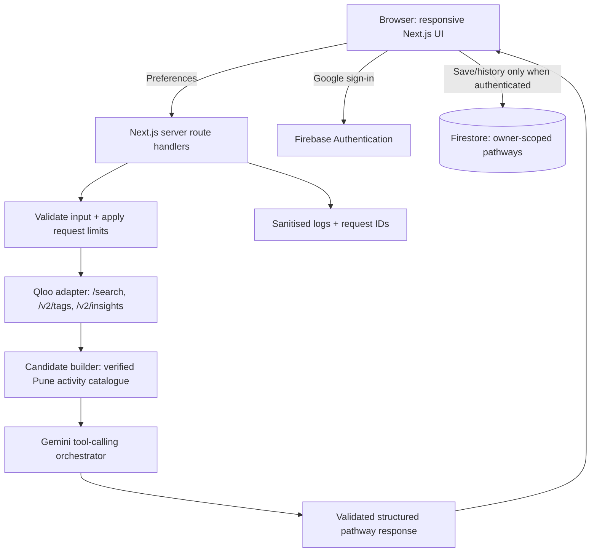

# Technical Requirements Document (TRD)

## 1. Technical overview

Build a mobile-first responsive web app using Next.js App Router, TypeScript and Tailwind CSS. Use Next.js server route handlers for Qloo/Gemini operations; Firebase Authentication for optional Google sign-in; Firestore for signed-in users' saved pathways; Vercel for hosting. The AI experience is a bounded tool-calling workflow, not an unconstrained autonomous agent.

## 2. System boundaries

### In scope
- Browser UI and onboarding state.
- Server-owned Qloo API adapter.
- Server-owned Gemini adapter with validated tool calling.
- Curated/source-backed Pune activity dataset and a narrow adapter for any later verified live provider.
- Deterministic constraints and candidate normalisation.
- Qloo-vs-baseline benchmark mode.
- Firebase Google sign-in and owner-scoped Firestore history.
- Tests, env template, production build, Vercel deployment.

### Out of scope
- Native mobile code, messaging, social graph, RSVP/bookings/payment, event submission, live map routing, multi-city, admin console, arbitrary browser/search agent tools.

## 3. Stack direction

- Next.js App Router + TypeScript.
- Tailwind CSS; custom components guided by `UI_REFERENCE_SPEC.md`.
- Zod or equivalent schema validation for all external/request/model boundaries.
- Official Google Gen AI SDK compatible with the selected Gemini model and tool/function calling (verify current SDK guidance before coding; don't guess API names).
- Firebase JS SDK for Auth and client-owned Firestore writes/reads under strict rules. Use the Admin SDK only if a concrete server-owned operation requires it; no service-account JSON in source control.
- Vercel functions/server routes for server-side API requests.
- Test runner can be Vitest/Jest and Playwright or another existing fit; pick one coherent, light toolchain and document commands.

Do not add a separate backend service, database or agent framework unless a genuine tested requirement cannot be met by this stack.

## 4. Proposed architecture

Benchmark mode invokes two arms over the same validated inputs and candidate pool:

- **Baseline arm:** Gemini receives user preferences + the verified activity candidates; it receives no Qloo results or affinity/explainability data.
- **Qloo arm:** Gemini receives the same preferences/candidates plus actual normalized Qloo outputs and explainability metadata when available.

Don't give the Qloo arm a larger/handpicked candidate set than the baseline. If Qloo discovers a candidate that is not yet in the verified catalogue, verify and add it to the shared catalogue before benchmarking, or omit it from that comparison run.

## 5. Server/client responsibilities

### Browser/client
- Collect only approved preferences.
- Render pathway/benchmark states from validated server responses.
- Handle optional Google sign-in.
- Read/write the current user's saved pathway documents using Firebase client SDK and strict Firestore rules (or a reviewed server route if selected during implementation).
- Never possess Qloo or Gemini keys.
- Never call Qloo directly.

### Server
- Validate inputs and normalize preference values.
- Resolve cultural entities/tags via Qloo supporting APIs.
- Make documented Qloo Insights requests and normalize minimal fields.
- Query/filter the verified local activity dataset.
- Orchestrate Gemini with a finite tool-call cap.
- Enforce constraints before and after the LLM step.
- Validate final pathway against schema and candidate IDs.
- Return only the minimal normalized results needed by the browser.
- Sanitize logs; never return private provider credentials or raw error stacks.

## 6. Qloo integration requirements

See `QLOO_INTEGRATION.md` for documented URLs, supported entity types, and request examples. Use the hackathon base URL, `X-Api-Key`, `/search`, `/v2/insights`, and `/v2/tags` only as appropriate. Current documentation must be re-checked while implementing each concrete parameter combination.

Important: Qloo cultural/place results do not prove an event/group is actually running. The verified activity catalogue is a distinct layer.

## 7. Gemini agent workflow

Implement an explicit, auditable sequence:

1. Validate the `GeneratePathwayInput`.
2. Resolve favourite entities/tags using Qloo.
3. Obtain location-aware insights with documented supported parameters.
4. Filter approved activity records using deterministic hard constraints (budget, selected area/radius if coordinates exist, available days/time when known).
5. Ask Gemini to rank/sequence the same candidate set and return exactly three primary steps plus a small number of alternatives, with candidate IDs and grounded reasons.
6. Validate schema and references. Drop any hallucinated candidate IDs; reject invented event-specific facts.
7. If invalid, perform at most one repair attempt with validation errors; then fail clearly.
8. Return provider status, source metadata and pathway.

Suggested bounded limits: maximum four agent/model rounds per generation, one schema-repair attempt, maximum twenty candidate records passed to the final ranking call, maximum five alternatives total per pathway. Keep these as constants and adjust only with evidence; do not create an open-ended loop.

Use a strict JSON schema for tool arguments and final output. Tools must be a fixed allow-list. Do not expose tools for arbitrary web requests, shell commands, arbitrary Firestore queries/writes, or code execution.

## 8. Candidate ranking and hard constraints

Hard constraints should be deterministic and not delegated only to the LLM:
- Pune city/selected allowed area where record location is known.
- Budget ceiling when a verified cost is present. If cost is unknown, mark it unknown and either exclude it when the user explicitly requires an exact ceiling or allow it only if UI clearly says cost is unknown (make this policy consistent and document it).
- Day/time only when a verified schedule exists. Do not infer event dates or current availability.
- Social comfort is a ranking preference, not a fact unless the activity source/curation supports the label. Store the label's basis in the activity metadata; if unknown, label unknown.
- Diversity: avoid three nearly identical activities where viable alternatives exist.
- Pathway sequence: first step should be an approachable entry point; second step can deepen the shared interest; third should favour recurring participation when verified records exist. Do not falsely imply one event causes membership or friendship.

## 9. Firebase and persistence

- Google sign-in is optional until a user saves/views history.
- Guests can generate results in the current session; do not require storing anonymous preference profiles remotely.
- Persist only user's saved pathway, minimal preferences needed to show/replay it, selected activity IDs/snapshot fields, source status, creation time and model/benchmark provenance that is safe to retain.
- Do not persist raw Qloo response bodies or secrets.
- Use `users/{uid}/pathways/{pathwayId}` or an equivalently owner-scoped structure.
- Rules must require `request.auth.uid == uid`; check document field shape/size and prevent cross-owner access. No public read. Test with Firebase Emulator Suite when feasible, otherwise automated rule tests using an equivalent project test setup plus explicit deployment verification.

## 10. Performance, caching and limits

- Prefer concurrent independent lookup calls only where provider quota and latency allow.
- Use a private server-side cache for repeat entity resolutions/insight requests when safe. The Qloo hackathon guide permits private server-side caching but forbids placing Qloo response data in public repositories. Cache keys must include normalized inputs and should not embed secrets or raw personal data.
- Deduplicate repeated requests when the same input is generated in a short window.
- Apply request-size limits, generation throttles and a finite tool-call count. If rate limiting uses in-memory state on Vercel, clearly document it as best-effort and do not claim durable global rate limiting.
- Configure timeouts for Qloo and Gemini and map 401/403/404/429/5xx/timeout/empty results to typed errors.

## 11. Environment configuration

Required/expected names are in `.env.example`. Qloo base defaults to the hackathon URL; keys are server-only. Firebase client config may use `NEXT_PUBLIC_` values because Firebase web config is client configuration, but access control depends on security rules. Gemini key is server-only. Vercel Environment Variables must be configured separately for Preview and Production as needed.

## 12. Deployment

- Fresh public repository.
- Reproducible install/lockfile and documented scripts.
- CI runs lint, typecheck, tests and production build.
- Vercel deployment with HTTPS.
- Post-deploy smoke tests cover guest generation, actual Qloo response, baseline vs Qloo comparison, Google sign-in, save/history, and error handling.
- Never include `.env.local`, service-account files, API payload dumps or credentials in the public repository.

## 13. Architecture decision record requirements

If the implementing agent changes an important detail (auth flow, provider SDK, persistence access path, cache or live-data source), add a concise entry to `DECISION_LOG.md` with reason, impact and tests. Do not change product scope or UI direction without explicit owner approval.
